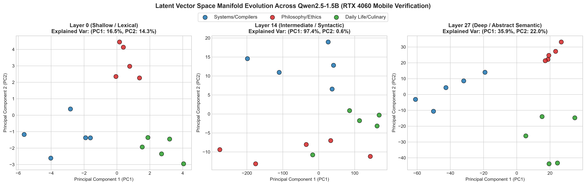

# nano-qwen

[English](#english) · [简体中文](#chinese)

---

<a id="english"></a>

## English

A standalone PyTorch reimplementation of Qwen2.5-1.5B in ~250 lines of code.

It directly parses and maps weights from local GGUF binaries into custom PyTorch modules without relying on Hugging Face `transformers` modeling code. Tested on consumer hardware (RTX 4060 Laptop GPU, ~3.44 GB peak VRAM in BF16).

### Repository Structure

| File | Description |
|---|---|
| `model.py` | Complete Qwen2.5 architecture (~250 LOC). Implements Grouped Query Attention (12 Q heads, 2 KV heads), RoPE ($\theta=10^6$), SwiGLU MLP, RMSNorm, and weight tying. |
| `load_and_verify.py` | Reads raw GGUF tensors with `gguf-py`, maps keys into `model.py`, and runs greedy text generation. |
| `custom_attention.py` | Manual causal multi-head / grouped-query attention benchmarked against `torch.nn.functional.scaled_dot_product_attention`. |
| `latent_probe_pca.py` | Extracts hidden states across layers (0, 14, 27) across multi-domain prompts and projects them via PCA. |
| `figures/` | Visualizations generated by probing scripts. |

### Quickstart

#### 1. Setup Environment
```bash
git clone https://github.com/AshenJyy/nano-qwen.git
cd nano-qwen

# Create virtual environment (Python 3.10+)
uv venv .venv --python 3.12
.venv\Scripts\activate   # Linux/macOS: source .venv/bin/activate

# Install PyTorch with CUDA (adjust CUDA version as needed)
uv pip install torch --index-url https://download.pytorch.org/whl/cu124
uv pip install numpy gguf transformers scikit-learn matplotlib
```

#### 2. Prepare Model Weights
Download the official Qwen2.5-1.5B-Instruct GGUF (e.g., `qwen2.5-1.5b-instruct-fp16.gguf` or similar):
```bash
# Example via huggingface-cli
huggingface-cli download Qwen/Qwen2.5-1.5B-Instruct-GGUF qwen2.5-1.5b-instruct-fp16.gguf --local-dir ./weights
```
Update `GGUF_PATH` in `load_and_verify.py` to point to your local file.

#### 3. Run Scripts

**Inference & Verification:**
```bash
python load_and_verify.py
```

**Benchmark Custom vs PyTorch SDPA:**
```bash
python custom_attention.py
```

**Probing Layer Latents (PCA):**
```bash
python latent_probe_pca.py
```

---

### Model Architecture

Matches the official Qwen2.5-1.5B specification:

| Parameter | Value |
|---|---|
| Vocabulary Size | 151,936 |
| Hidden Dimension | 1,536 |
| Transformer Layers | 28 |
| Attention Heads | 12 Q heads, 2 KV heads (GQA, 6:1) |
| Head Dimension | 128 |
| Intermediate Size | 8,960 (SwiGLU) |
| RoPE Base ($\theta$) | 1,000,000 |
| Weight Tying | True |
| Total Parameters | ~1.54B |

### Memory & Performance

- **Weights Footprint (BF16)**: ~2.88 GB
- **Peak VRAM (Inference)**: ~3.44 GB (runs comfortably on 6 GB / 8 GB consumer GPUs)

#### Attention Benchmark (`seq_len=128`, batch=1, RTX 4060 Mobile)

| Implementation | Latency | Memory Overhead Delta |
|---|---|---|
| PyTorch Native SDPA (`F.scaled_dot_product_attention`) | 65.80 ms | Baseline |
| Custom Explicit Attention | 65.82 ms | 0.00 MB |

#### Layer Representation Evolution

Hidden states extracted at layers 0, 14, and 27 across 15 prompts in 3 semantic domains (Systems/Compilers, Philosophy/Ethics, Daily Life), projected to 2D via PCA:



Early layers (layer 0) capture primarily token-level lexical patterns with overlapping distributions. By middle and final layers (layers 14 and 27), representations separate into distinct semantic clusters.

---

### References

- [nanoGPT](https://github.com/karpathy/nanoGPT) by Andrej Karpathy
- [Qwen2.5](https://github.com/QwenLM/Qwen2.5) by Alibaba Cloud

### License

MIT License.

---

<a id="chinese"></a>

## 简体中文

基于 PyTorch 从零实现的 Qwen2.5-1.5B 独立模型，核心架构代码约 250 行。

无需依赖 Hugging Face `transformers` 的模型建模层，直接解析本地 GGUF 二进制权重并映射至纯 PyTorch 模块。可在消费级显卡顺畅运行（在 RTX 4060 笔记本显卡实测，BF16 峰值显存占用约 3.44 GB）。

### 项目结构

| 文件 | 说明 |
|---|---|
| `model.py` | 完整的 Qwen2.5 模型架构（约 250 行代码）。包含分组查询注意力（12 Q 头，2 KV 头）、旋转位置编码 RoPE（$\theta=10^6$）、SwiGLU MLP、RMSNorm 与权重绑定（Weight Tying）。 |
| `load_and_verify.py` | 使用 `gguf-py` 解析本地 GGUF 权重，转换键名注入模型并执行贪心解码验证。 |
| `custom_attention.py` | 显式实现的因果注意力模块，并与 PyTorch 原生 `scaled_dot_product_attention` (SDPA) 进行吞吐与显存基准对比。 |
| `latent_probe_pca.py` | 提取不同层（第 0、14、27 层）在多领域 Prompt 下的隐藏状态激活值，通过 PCA 降维观察表征演化。 |
| `figures/` | 探测脚本生成的数据可视化图表。 |

### 快速开始

#### 1. 配置环境
```bash
git clone https://github.com/AshenJyy/nano-qwen.git
cd nano-qwen

# 创建虚拟环境（推荐 Python 3.10+）
uv venv .venv --python 3.12
.venv\Scripts\activate   # Linux/macOS: source .venv/bin/activate

# 安装 PyTorch 与 CUDA 依赖
uv pip install torch --index-url https://download.pytorch.org/whl/cu124
uv pip install numpy gguf transformers scikit-learn matplotlib
```

#### 2. 准备模型权重
下载官方 Qwen2.5-1.5B-Instruct GGUF 权重（例如 `qwen2.5-1.5b-instruct-fp16.gguf`）：
```bash
# 使用 huggingface-cli 下载示例
huggingface-cli download Qwen/Qwen2.5-1.5B-Instruct-GGUF qwen2.5-1.5b-instruct-fp16.gguf --local-dir ./weights
```
将 `load_and_verify.py` 中的 `GGUF_PATH` 改为你本地权重的实际路径。

#### 3. 运行脚本

**文本生成与验证：**
```bash
python load_and_verify.py
```

**注意力机制基准测试：**
```bash
python custom_attention.py
```

**隐藏层表征演化可视化 (PCA)：**
```bash
python latent_probe_pca.py
```

---

### 模型架构参数

完全对齐 Qwen2.5-1.5B 官方架构规格：

| 架构参数 | 配置值 |
|---|---|
| 词表大小 (Vocab Size) | 151,936 |
| 隐藏层维度 (Hidden Size) | 1,536 |
| Transformer 层数 (Layers) | 28 |
| 注意力头数 (Heads) | 12 Q 头，2 KV 头 (GQA，比例 6:1) |
| 单头维度 (Head Dim) | 128 |
| 前馈层中间维度 (Intermediate) | 8,960 (SwiGLU) |
| RoPE 基数 ($\theta$) | 1,000,000 |
| 词嵌入与输出头绑定 (Weight Tying) | 是 |
| 总参数量 | 约 1.54B |

### 显存占用与性能实测

- **BF16 权重体积**：约 2.88 GB
- **推理峰值显存**：约 3.44 GB（可在 6 GB / 8 GB 显存的消费级显卡从容运行）

#### 注意力基准测试 (`seq_len=128`, batch=1, RTX 4060 Mobile)

| 实现方式 | 耗时 | 显存增量 |
|---|---|---|
| PyTorch 原生 SDPA (`F.scaled_dot_product_attention`) | 65.80 ms | 基准值 |
| 自定义显式因果注意力 (Custom Attention) | 65.82 ms | 0.00 MB |

#### 逐层表征演化分析

从 3 个不同语意领域（系统/编译器、哲学/伦理、日常对话）中选取 15 条 Prompt，分别提取第 0、14、27 层的隐藏层激活值并进行二维 PCA 投影：


- **浅层（Layer 0）**：主要捕捉词法与 Token 级别的表层特征，不同语义领域的点分布重叠。
- **中深层（Layer 14 & 27）**：模型抽象能力增强，表征逐渐分离成边界清晰的语义簇。

---

### 参考项目

- [nanoGPT](https://github.com/karpathy/nanoGPT) - Andrej Karpathy
- [Qwen2.5](https://github.com/QwenLM/Qwen2.5) - 阿里云通义千问团队

### 开源协议

本项目采用 MIT 许可证。
